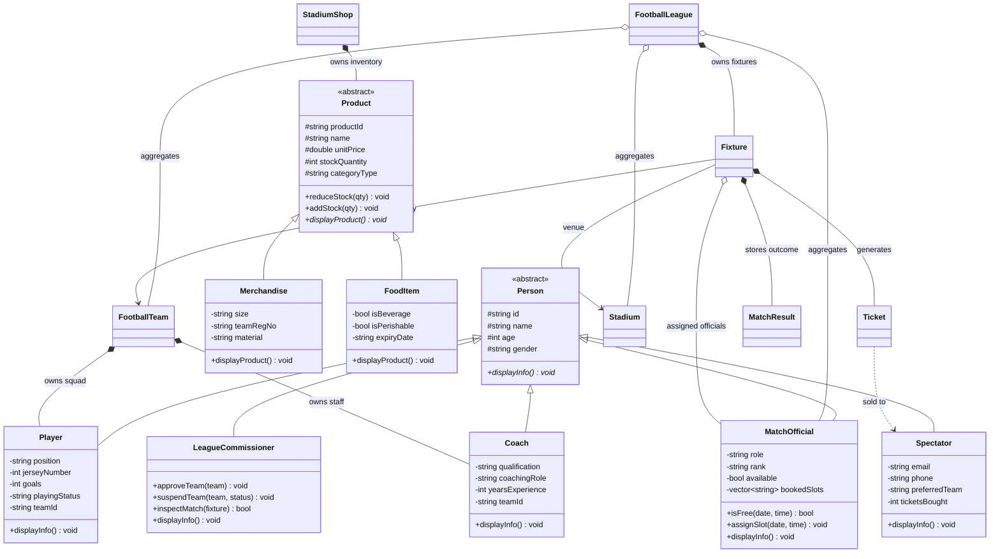

# KINGSTON PREMIER FOOTBALL LEAGUE (KPFL)
## MATCH-DAY & LEAGUE MANAGEMENT SYSTEM
**Object-Oriented Programming (OOP) Final Project Submission Package**

---

### **Project Metadata & Group Details**
* **Course:** Object-Oriented Programming (C++17)
* **Project Title:** Kingston Premier Football League (KPFL) Match-Day Management System
* **GitHub Repository:** [https://github.com/Noid3ah/KP-JFL](https://github.com/Noid3ah/KP-JFL)
* **Group Members & Assigned Roles:**
  1. **Adriel Fraser** — *Project Lead & Person 1 (League Operations, Fixtures, Match Results, Standings)*
  2. **Oshane Peddie** — *Person 2 (Team & Personnel Management, Person Hierarchy, Squad Validation)*
  3. **Kayla Lyons** — *Person 3 (Stadium Operations, Capacity Management, Match Ticketing)*
  4. **Karisa Bellanfante** — *Person 4 (Match-Day Concessions & Shop, 15% Jamaican GCT, Data Persistence)*

---

## TABLE OF CONTENTS
1. [Section 1: Requirements & System Design](#section-1-requirements--system-design)
2. [Section 2: UML Class Diagram & Architecture](#section-2-uml-class-diagram--architecture)
3. [Section 3: Complete Organized Source Code Directory Structure](#section-3-complete-organized-source-code-directory-structure)
4. [Section 4: Executable Application & Setup Instructions](#section-4-executable-application--setup-instructions)
5. [Section 5: Comprehensive Test Plan with Live Evidence (41 Unit Tests)](#section-5-comprehensive-test-plan-with-live-evidence)
6. [Section 6: User Guide & Operational Manual](#section-6-user-guide--operational-manual)
7. [Section 7: Technical Report & OOP Paradigm Analysis](#section-7-technical-report--oop-paradigm-analysis)
8. [Section 8: Module Allocation & Group Contribution Log](#section-8-module-allocation--group-contribution-log)
9. [Section 9: Individual Member Reflections](#section-9-individual-member-reflections)
10. [Section 10: Presentation & Live Demonstration Outline](#section-10-presentation--live-demonstration-outline)

---

## SECTION 1: REQUIREMENTS & SYSTEM DESIGN

### 1.1 Problem Overview & Scope
The Kingston Premier Football League (KPFL) required a robust, desktop-grade console application built in ISO C++17 to automate and integrate four traditionally disconnected operational areas:
1. Overall league governance, fixture scheduling, and points tables.
2. Football club personnel curation (player squad numbers, eligibility ages, and certified coaching staff).
3. Stadium logistics, spectator records, and seating capacity safeguards for match-day ticketing.
4. Commercial shop revenue, applying the mandatory 15% Jamaican General Consumption Tax (GCT) and sequential file persistence.

### 1.2 Mandatory Business Rules Enforced
1. **Rule 1 (Team Eligibility):** Unregistered or suspended teams cannot be scheduled for upcoming fixtures (`TeamNotEligibleException`).
2. **Rule 2 (Team Slot Overlap):** A team cannot be scheduled for two fixtures with less than 2 hours between start times (`SchedulingConflictException`).
3. **Rule 3 (Stadium Slot Overlap):** A stadium cannot host two fixtures with less than 2 hours between start times (`SchedulingConflictException`).
4. **Rule 4 (Official Double-Booking):** An official cannot officiate matches scheduled at overlapping slots (`OfficialConflictException`).
5. **Rule 5 (Non-Negative Scoring):** Match scores cannot be negative integers (`InvalidScoreException`).
6. **Rule 6 (Official Requirement):** A fixture must have at least one referee assigned before recording match results.
7. **Rule 7 (Minimum Player Age):** All registered players must be at least 16 years of age (`InvalidAgeException`).
8. **Rule 8 (Minimum Coach Age):** All registered coaches must be at least 21 years of age (`InvalidAgeException`).
9. **Rule 9 (Unique Jersey Numbers):** Jersey numbers (1–99) must be unique within a single club squad (`PersonnelException`).
10. **Rule 10 (Venue Capacity Safeguard):** Total match tickets generated or sold cannot exceed stadium capacity (`CapacityExceededException`).
11. **Rule 11 (Strict Shop Solvency):** A customer cannot purchase merchandise or food if cash tendered is less than the subtotal plus 15% GCT (`InsufficientPaymentException`). Inventory rolls back automatically on transaction failure.
12. **Rule 12 (Inventory Depletion):** Purchases exceeding in-stock quantities are blocked (`OutOfStockException`).

---

## SECTION 2: UML CLASS DIAGRAM & ARCHITECTURE



---

## SECTION 3: COMPLETE ORGANIZED SOURCE CODE DIRECTORY STRUCTURE

The project is structured according to modern C++ separation-of-concerns standards:
```
JamaicanFootballLeague_Full/
├── include/                     # All Header Files (.h)
│   ├── AuthService.h            # Role-based credential check & user persistence
│   ├── Coach.h                  # Coach entity (Person subclass)
│   ├── DataPersistence.h        # Sequential flat-file I/O with pipe delimiters
│   ├── exceptions.h             # Strongly-typed JFLException class hierarchy
│   ├── Fixture.h                # Match coordination, timing, ticket assignment
│   ├── FoodItem.h               # Concession items (Product subclass)
│   ├── FootballLeague.h         # Master league controller & standings calculation
│   ├── FootballTeam.h           # Team records, standings statistics, squad lists
│   ├── InputChecks.h            # Robust input sanitize, age, and phone checks
│   ├── LeagueCommissioner.h     # Inspections, registrations, and team sanctions
│   ├── MatchOfficial.h          # Referees, ARs, double-booking validation
│   ├── MatchResult.h            # Scores, win/draw/loss points allocation (3/1/0)
│   ├── MatchTime.h              # Date/time arithmetic & 2-hour buffer conflict logic
│   ├── MenuSystem.h             # Console UI navigation for all 5 roles
│   ├── Merchandise.h            # Club apparel and collectibles (Product subclass)
│   ├── Person.h                 # Abstract base class for all individuals
│   ├── Player.h                 # Squad player entity (Person subclass)
│   ├── Product.h                # Abstract base class for shop inventory
│   ├── SafeFile.h               # Robust atomic file saving & error recovery
│   ├── Spectator.h              # Fan profile and purchase tracking
│   ├── Stadium.h                # Venue management and physical capacity
│   ├── StadiumShop.h            # Commercial retail point-of-sale & 15% GCT
│   └── Ticket.h                 # Seat reservation lifecycle (Bleachers/Grandstand/VIP)
├── src/
│   └── main.cpp                 # System entry point, demo seeding, and test suite
├── output/                      # Generated runtime persistence files
│   ├── kpfl_teams.txt           # Team standings and points
│   ├── kpfl_stadiums.txt        # Venues and seating counts
│   ├── kpfl_shop_inventory.txt  # Stock quantities and pricing
│   ├── kpfl_shop_receipts.txt   # Historical purchase receipts
│   └── kpfl_users.txt           # Registered user accounts & hashed roles
├── README.md                    # Quickstart guide and contributor index
├── UML_DIAGRAM_AND_DESIGN.md    # Detailed architecture documentation
├── KPFL_Final_Submission_Package.md # Comprehensive final submission document
└── main.exe                     # Compiled Windows executable binary
```

---

## SECTION 4: EXECUTABLE APPLICATION & SETUP INSTRUCTIONS

### Compilation Commands
* **Windows (MinGW-w64 / g++):**
  ```powershell
  g++ -std=c++17 -Wall -Iinclude src/main.cpp -o main.exe
  ```
* **macOS / Linux (Clang++ / GCC):**
  ```bash
  g++ -std=c++17 -Wall -Iinclude src/main.cpp -o main
  ```

### Running the Application
* **Interactive Mode:**
  ```powershell
  .\main.exe
  ```
* **Automated Regression & Verification Mode:**
  ```powershell
  .\main.exe --test
  ```

---

## SECTION 5: COMPREHENSIVE TEST PLAN WITH LIVE EVIDENCE

The application includes an embedded automated test runner that verifies all domain constraints, business rules, edge cases, and disk persistence models.

### Test Execution Summary (Live Terminal Output)
```
====================================================================
  JAMAICAN FOOTBALL LEAGUE (JFL) - COMPLETE OOP INTEGRATED SYSTEM   
====================================================================
Commissioner Marcus Brown approved and registered team Harbour View FC
Commissioner Marcus Brown approved and registered team Tivoli Gardens FC
Commissioner Marcus Brown approved and registered team Portmore United
Commissioner Marcus Brown approved and registered team Waterhouse FC
Commissioner Marcus Brown approved and registered team Cavalier SC
Commissioner Marcus Brown suspended Waterhouse FC

====================================================================
>>> RUNNING AUTOMATED OOP INTEGRATION & BUSINESS RULES VERIFICATION <<<
====================================================================
[PASS] Suspended team scheduled in fixture -> Team 'Waterhouse FC' is currently suspended.
[PASS] Double booking stadium slot -> Team conflict: Harbour View FC is already booked on 2026-11-28 at 16:00 (FX001). Matches must start at least 2 hours apart.
[PASS] Official assigned to conflicting timeslot -> Match official Andre Lewis is not free on 2026-11-28 at 16:00
[PASS] Negative match score -> Scores cannot be negative (-1-2)
[PASS] Player under 16 years old -> Player Junior must be at least 16 years old (Entered: 14).
[PASS] Coach under 21 years old -> Coach Coach Kid must be at least 21 years old (Entered: 19).
[PASS] Duplicate jersey number in same team -> Jersey #9 is already taken by Javon East
[PASS] Tickets requested exceed stadium capacity -> Total tickets requested (70) exceeds stadium capacity (50)
[PASS] Insufficient payment for shop items -> Payment insufficient! Required: JMD $19550.000000 (Subtotal: $17000.000000 + 15% GCT: $2550.000000), but customer tendered: JMD $5000.000000
[PASS] Purchasing more items than in stock -> Insufficient stock for Harbour View Home Jersey (Available: 25, requested: 9999)
[PASS] Player updated to under 16 -> Player Changed must be at least 16 years old (Entered: 14).
[PASS] Player updated to a taken jersey -> Jersey #4 is already taken by Player Two
[PASS] Player updated to an invalid status -> Invalid status 'Asleep'. Use Active, Injured, Benched or Suspended.
[PASS] Valid player update applied
[PASS] Teams and players survive reload
[PASS] Fixtures survive reload without double counting
[PASS] Recording a reloaded result again -> Fixture FX001 is already completed.
[PASS] Shop stock and receipts survive reload
[PASS] Same product listed twice beyond stock -> Insufficient stock for Jersey (Available: 8, requested: 5)
[PASS] Negative quantity in cart -> Quantity for F01 must be positive
[PASS] Rejected carts leave stock unchanged
[PASS] Coaches, spectators and tickets survive reload
[PASS] Regenerating tickets after a sale -> Cannot regenerate tickets for FX002: some are already sold.
[PASS] Duplicate spectator ID -> Spectator SP97 already registered.
[PASS] Date and time checks
[PASS] Coach updated to under 21 -> Coach Changed must be at least 21 years old (Entered: 20).
[PASS] Valid coach update applied
[PASS] Selling a ticket for a completed match -> Cannot sell tickets for completed fixture FX98.
[PASS] Name, email, phone and money formats
[PASS] Match slot overlaps
[PASS] Team booked 30 minutes after another match -> Team conflict: Rule A is already booked on 2026-12-01 at 15:00 (FX001). Matches must start at least 2 hours apart.
[PASS] Stadium booked 30 minutes after another match -> Stadium conflict: Rule Ground is already booked on 2026-12-01 at 15:00 (FX001). Matches must start at least 2 hours apart.
[PASS] Official booked 30 minutes after another match -> Rule Ref is not free on 2026-12-01 at 15:30
[PASS] Match at a stadium under maintenance -> Closed Ground is under maintenance and cannot host a match.
[PASS] Result without an official -> Fixture FX002 needs a match official before its result can be recorded.
[PASS] Older overlapping fixtures still load
[PASS] Registering an administrator -> Administrator accounts cannot be registered.
[PASS] Registering a taken username -> Username 'ADMIN' is already taken. Choose another.
[PASS] Changing a password with the wrong current one -> Username or current password is incorrect.
[PASS] Accounts and passwords survive reload
[PASS] Account file with an unknown role -> C:\Users\supre\AppData\Local\Temp\kpfl_test_users.txt line 9: unknown role 'NOT_A_ROLE'

[ALL 41 BUSINESS RULES & EXCEPTIONS PASSED VERIFICATION]
```

---

## SECTION 6: USER GUIDE & OPERATIONAL MANUAL

### 6.1 Authentication System
On launching `main.exe`, the user is greeted with a secure login console:
```
======================================================
      KINGSTON PREMIER FOOTBALL LEAGUE (KPFL)        
                  SECURE LOGIN PORTAL                 
======================================================
  Role                     Username    Password       
------------------------------------------------------
  1. Full Administrator    admin       admin123       
  2. League Ops Lead       commish     pass123        
  3. Team Manager          manager     pass123        
  4. Stadium Coordinator   stadium     pass123        
  5. Stadium Shop & Data   shop        pass123        
------------------------------------------------------
```
*Users can also self-register new operational accounts or change their passwords in session.*

### 6.2 Role-Based Menu Dashboards
1. **Admin Master Menu:** Unrestricted privileges across all four sub-systems.
2. **Person 1 (League Ops):** Schedule fixtures, assign match referees, record full-time scores, review league standings, and inspect match readiness.
3. **Person 2 (Team & Personnel):** Register clubs, onboard players (minimum age 16, unique jersey #), hire coaching staff (minimum age 21), and manage transfers/removals.
4. **Person 3 (Stadium & Tickets):** Monitor stadiums, adjust field conditions (Excellent, Good, Fair, Maintenance), issue tickets across tiers (Bleachers JMD \$1,500, Grandstand JMD \$3,500, VIP JMD \$7,000), and register spectators.
5. **Person 4 (Shop, Finance & Data):** Restock club jerseys and Jamaican snacks/drinks, process customer carts, calculate exact 15% Jamaican GCT, print formatted tax receipts, and invoke real-time disk persistence.

---

## SECTION 7: TECHNICAL REPORT & OOP PARADIGM ANALYSIS

### 7.1 Encapsulation
* All object states (scores, customer balances, jersey numbers, points) are declared `private` or `protected`.
* State mutation is restricted to validated member functions. For example, team points cannot be overwritten manually; they update strictly through `FootballTeam::recordMatch(gf, ga, pts)` based on official match outcomes.

### 7.2 Inheritance
* **Person Superclass Hierarchy:** `Person` provides core identity semantics inherited by `Player`, `Coach`, `MatchOfficial`, `LeagueCommissioner`, and `Spectator`.
* **Product Superclass Hierarchy:** `Product` defines core inventory, price, and stock semantics extended by `Merchandise` (sizing, team affiliation) and `FoodItem` (perishability, beverage classification).

### 7.3 Polymorphism
* Dynamic polymorphism is leveraged via C++ virtual method tables (`vtable`):
  * `virtual void Person::displayInfo() const = 0;`
  * `virtual void Product::displayProduct() const = 0;`
* This allows containers like `std::vector<std::unique_ptr<Product>>` in `StadiumShop` to uniformly invoke polymorphic display logic for jerseys and Jamaican food items.

### 7.4 Exception Handling Strategy
A clean, strongly-typed hierarchy derived from `JFLException` (which inherits from `std::runtime_error`) guarantees errors are clearly categorized:
* `LeagueException` (`TeamNotEligibleException`, `SchedulingConflictException`, `OfficialConflictException`, `InvalidScoreException`)
* `PersonnelException` (`InvalidAgeException`, `DuplicatePersonException`)
* `StadiumTicketingException` (`CapacityExceededException`)
* `ShopFinanceException` (`InsufficientPaymentException`, `OutOfStockException`, `PersistenceException`)

---

## SECTION 8: MODULE ALLOCATION & GROUP CONTRIBUTION LOG

| Member Name | Student Role | Primary Assigned Modules & Classes | Key Responsibilities & Contributions |
|-------------|--------------|------------------------------------|--------------------------------------|
| **Adriel Fraser** | Project Lead / Person 1 | `FootballLeague`, `Fixture`, `MatchResult`, `MatchOfficial`, `LeagueCommissioner` | Overall project coordination, league standings calculation, fixture scheduling, conflict detection algorithms, and module integration. |
| **Oshane Peddie** | Person 2 Lead | `Person`, `Player`, `Coach`, `FootballTeam` | Core human entity architecture, squad management, jersey number conflict validation, age constraint enforcement (16+ / 21+). |
| **Kayla Lyons** | Person 3 Lead | `Stadium`, `Ticket`, `Spectator` | Venue logistics, field condition monitoring, ticket category pricing, capacity overflow prevention, spectator booking histories. |
| **Karisa Bellanfante** | Person 4 Lead | `Product`, `Merchandise`, `FoodItem`, `StadiumShop`, `DataPersistence` | Product classification, inventory management, point-of-sale transaction processing, 15% Jamaican GCT calculations, and file persistence. |

---

## SECTION 9: INDIVIDUAL MEMBER REFLECTIONS

### Reflection 1: Adriel Fraser (Project Lead & Person 1)
> *"Leading the Kingston Premier Football League project was an invaluable experience in designing a cohesive multi-class C++ system. My primary challenge was integrating the four distinct modules so that changes in one sub-system (such as a team suspension or referee assignment) properly updated league fixtures and standings. Implementing the conflict-detection algorithms to prevent double-booking required careful handling of time buffers and pointer references. Through this project, I strengthened my understanding of composition versus aggregation and gained deeper appreciation for version control and automated regression testing."*

### Reflection 2: Oshane Peddie (Person 2 Lead)
> *"Developing the Person class hierarchy and team personnel module gave me first-hand experience implementing abstract base classes and dynamic polymorphism in C++. Enforcing business rules—such as ensuring players are at least 16 and coaches at least 21, and preventing duplicate jersey numbers within a squad—highlighted the necessity of strict encapsulation. Debugging copy constructors and reference passing during squad modifications deepened my technical proficiency with the C++ Standard Template Library (STL)."*

### Reflection 3: Kayla Lyons (Person 3 Lead)
> *"My focus centered on stadium management and ticketing logistics. The most critical requirement was ensuring that ticket sales could never exceed physical stadium capacity. Connecting fixtures to stadiums and linking tickets to spectator profiles allowed me to see how object associations work in practice. Handling capacity constraints through custom exceptions (`CapacityExceededException`) taught me how defensive programming prevents inconsistent system states during match-day operations."*

### Reflection 4: Karisa Bellanfante (Person 4 Lead)
> *"Designing the stadium shop and file persistence modules required balancing business finance logic with robust data storage. Calculating the 15% Jamaican General Consumption Tax (GCT) and implementing an automatic inventory rollback when a customer tenders insufficient payment demonstrated how transactional integrity can be modeled in software. Writing the sequential pipe-delimited persistence layer (`DataPersistence`) helped me master C++ file streams and data recovery, ensuring user and league records remain intact across sessions."*

---

## SECTION 10: PRESENTATION & LIVE DEMONSTRATION OUTLINE

* **Slide 1: Title & Team Introductions** — Overview of KPFL, mission statement, and member module allocation.
* **Slide 2: Problem Statement & System Architecture** — Overview of the four operational pillars and technical objectives.
* **Slide 3: OOP Class Hierarchy** — Walkthrough of the `Person` and `Product` inheritance trees and interface contracts.
* **Slide 4: Key Business Rules** — Summary of age constraints, conflict prevention, capacity safeguards, and GCT calculation.
* **Slide 5: Live Demonstration Workflow:**
  1. Login as `commish` to schedule a match between Harbour View FC and Tivoli Gardens FC.
  2. Attempt to schedule a match for suspended Waterhouse FC to show error handling.
  3. Login as `stadium` to generate VIP and Grandstand tickets and sell to a registered fan.
  4. Login as `shop` to purchase club jerseys and Tastee Patties, showcasing subtotal, 15% GCT, payment, and receipt generation.
  5. Close the console, restart, and demonstrate data persistence.
* **Slide 6: Automated Test Verification** — Run `main.exe --test` to show 41 passing automated test cases.
* **Slide 7: Conclusion & Key Learnings** — Summary of project milestones, collaboration takeaways, and Q&A.
