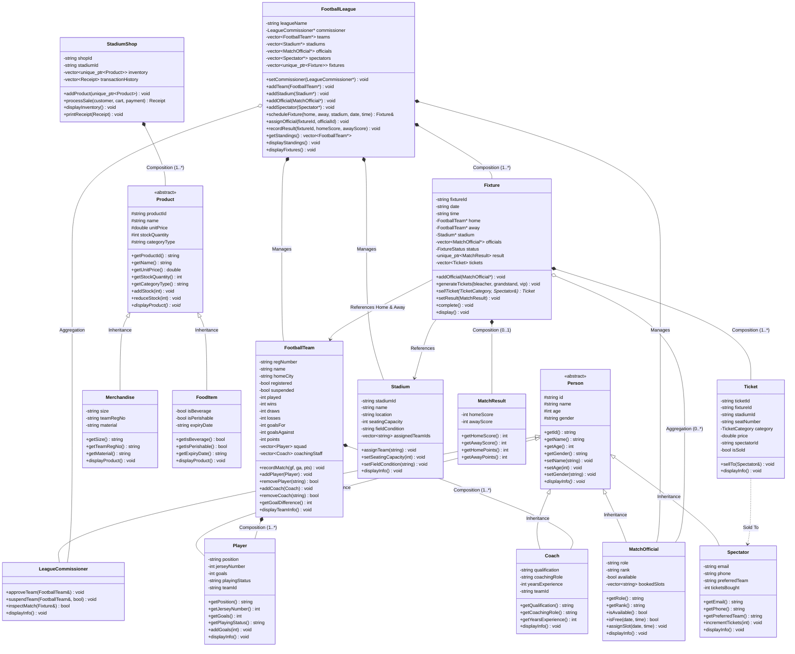

# Jamaican Football League (JFL) — UML Class Diagram & Architecture

This document provides the complete UML Class Diagram, inheritance structures, relationships, and responsibilities for all 4 roles in the **Kingston Premier Football League (KPFL) Management System**.

---

## 1. High-Level System Architecture & Class Hierarchy



---

## 2. Shared OOP Principles & Implementation Matrix

| OOP Pillar | Design Implementation in Project | Example in Code |
| :--- | :--- | :--- |
| **Encapsulation** | Private/protected attributes with public accessors, mutators, and business invariant checks. | `Person::age` protected; `FootballTeam::points` mutated only via `recordMatch()`. |
| **Inheritance** | Single inheritance hierarchies for people and shop goods. | `Person` $\rightarrow$ `Player`, `Coach`, `MatchOfficial`, `LeagueCommissioner`, `Spectator`.<br>`Product` $\rightarrow$ `Merchandise`, `FoodItem`. |
| **Polymorphism** | Overriding pure virtual methods called via superclass references or pointers. | `virtual void displayInfo() const = 0;`<br>`virtual void displayProduct() const = 0;` |
| **Abstraction** | Abstract base classes that define common contracts without exposing internal details. | Abstract classes `Person` and `Product`. |
| **Exception Handling** | Custom hierarchy derived from `JFLException` and `std::runtime_error`. | `TeamNotEligibleException`, `SchedulingConflictException`, `CapacityExceededException`, `InsufficientPaymentException`. |
| **File Persistence** | Flat-file serialization and reconstruction. | `DataPersistence::saveTeams()`, `DataPersistence::loadTeams()`, saving shop receipts and inventory. |

---

## 3. Four-Person Module Breakdown & Ownership

```mermaid
flowchart LR
    subgraph Person1["PERSON 1: LEAGUE OPERATIONS"]
        FL[FootballLeague]
        LC[LeagueCommissioner]
        FX[Fixture]
        MR[MatchResult]
        MO[MatchOfficial]
    end

    subgraph Person2["PERSON 2: TEAM & PERSONNEL"]
        P[Person (Abstract)]
        PL[Player]
        CO[Coach]
        FT[FootballTeam]
    end

    subgraph Person3["PERSON 3: STADIUM & TICKETING"]
        ST[Stadium]
        TK[Ticket]
        SP[Spectator]
    end

    subgraph Person4["PERSON 4: SHOP, FINANCE & DATA"]
        PR[Product (Abstract)]
        ME[Merchandise]
        FI[FoodItem]
        SS[StadiumShop]
        DP[DataPersistence]
    end

    Person2 -.->|Person Base Class| Person1
    Person2 -.->|Person Base Class| Person3
    Person1 <-->|Fixtures & Stadiums| Person3
    Person3 <-->|Spectators & Sales| Person4
    Person1 <-->|Teams in League| Person2
```

1. **Person 1 (League Operations)**:
   - Owns `FootballLeague`, `LeagueCommissioner`, `Fixture`, `MatchResult`, `MatchOfficial`.
   - Controls scheduling, standings computation ($Win=3, Draw=1, Loss=0$), official conflict prevention.
2. **Person 2 (Team & Personnel Management)**:
   - Owns `Person` (Abstract base), `Player`, `Coach`, `FootballTeam`.
   - Enforces age criteria (Players $\ge 16$, Coaches $\ge 21$), jersey uniqueness (1–99), and roster tracking.
3. **Person 3 (Stadium & Ticket Management)**:
   - Owns `Stadium`, `Ticket`, `Spectator`.
   - Manages seating capacities, categories (`BLEACHERS`, `GRANDSTAND`, `VIP`), and prevents overselling past capacity.
4. **Person 4 (Stadium Shop, Finance & Data)**:
   - Owns `Product` (Abstract base), `Merchandise`, `FoodItem`, `StadiumShop`, `DataPersistence`.
   - Handles transactions, **15% GCT (General Consumption Tax)**, item stock, receipt generation, and flat file saving/reloading.
